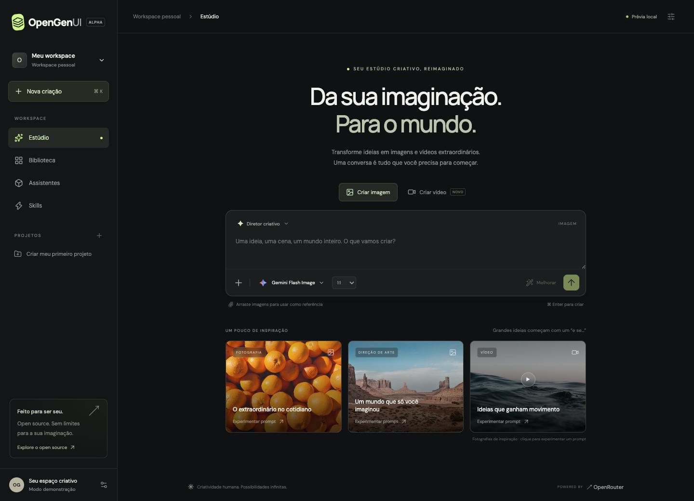

<div align="center">

# ✳ OpenGenUI

### Your imagination. An open canvas.

**Um estúdio conversacional open source para criar imagens e vídeos com IA.**  
Suas ideias, seus assistentes, seu armazenamento. Tudo em um só lugar.


[Começar](#começar) · [Funcionalidades](#o-que-já-existe) · [Arquitetura](docs/architecture.md) · [Contribuir](CONTRIBUTING.md) · [Roadmap](#roadmap)



</div>

## Uma conversa. Infinitas possibilidades.

OpenGenUI coloca a criação de mídia no centro da conversa. Escreva uma ideia, anexe referências, escolha um modelo e refine o resultado. Organize os arquivos em projetos e crie assistentes que conhecem seu estilo.

O projeto começa com OpenRouter como único provedor. A infraestrutura é sua: Postgres para dados, Redis para controle de requisições, Better Auth para contas e armazenamento privado compatível com S3, incluindo Cloudflare R2.

> **Early alpha.** A interface e as rotas estão implementadas. Gerações reais precisam de serviços configurados e créditos OpenRouter. Cadastro/login, isolamento entre contas, Redis e S3 local foram validados. Ainda não há validação ponta a ponta com provedores pagos. Esta versão não deve ser apresentada como pronta para produção pública.

## O que já existe

|                               | Funcionalidade                                                                                  |
| ----------------------------- | ----------------------------------------------------------------------------------------------- |
| ✦ **Estúdio conversacional**  | Prompt, referências por upload ou arrastar e soltar, proporção e seleção de modelo.             |
| ◈ **Imagens e vídeos**        | SDK oficial OpenRouter, catálogo dinâmico, imagens síncronas e acompanhamento de jobs de vídeo. |
| ↗ **Prompts melhores**        | Reescrita via modelo de texto, com instruções do assistente e atenção a movimento em vídeos.    |
| ◉ **Assistentes pessoais**    | Nome, personalidade, instruções e skills vinculadas.                                            |
| ⚡ **Skills em Markdown**     | Upload de `SKILL.md` e importação de URLs raw de repositórios encontrados no skills.sh.         |
| ▧ **Projetos e biblioteca**   | Organização de referências e resultados por conta; objetos privados em S3/R2.                   |
| ⤴ **Novas versões**           | Edição de imagem por referência, imagem para vídeo e regeneração de vídeo por prompt.           |
| ⌘ **Prévia sem configuração** | Explore a UI e crie projetos e assistentes localmente antes de conectar os serviços.            |

**Limites atuais:** imagens PNG/JPG/WebP de até 20 MB; até quatro referências de imagem e um primeiro frame para vídeo. Skills são instruções de texto: scripts, ferramentas e arquivos auxiliares não são executados. A importação do skills.sh exige abrir o repositório e copiar a URL raw do `SKILL.md`. Vídeos não possuem timeline, corte ou edição direta de frames. Projetos organizam arquivos; o chat é um único rascunho por workspace, sem histórico de conversas independentes.

## Começar

### 1. Explorar a interface

Requer Node.js 22+ e npm. Na raiz do repositório:

```bash
npm ci
npm run dev
```

Abra [localhost:3000](http://localhost:3000). Sem variáveis de ambiente, o modo demonstração salva projetos, assistentes e skills no navegador. Referências locais são temporárias e não sobrevivem ao recarregamento. Nenhuma geração paga é simulada.

### 2. Conectar a infraestrutura

```bash
cp .env.example .env.local
docker compose up -d
```

O Compose inicia Postgres, Redis e MinIO. As credenciais incluídas são **somente para desenvolvimento local**, com portas vinculadas ao loopback.

1. Abra o [console MinIO](http://localhost:59001), entre com os valores de `.env.example` e crie um bucket privado chamado `opengenui`.
2. Gere um segredo com `openssl rand -base64 32` e copie para `BETTER_AUTH_SECRET`.
3. Preencha `OPENROUTER_API_KEY` com sua chave OpenRouter.
4. Execute a migração usando as variáveis locais:

```bash
node --env-file=.env.local ./node_modules/drizzle-kit/bin.cjs migrate
npm run dev
```

No app, abra **Configurações → Conectar minha conta → Crie a sua**. A demonstração local não é importada automaticamente para uma conta.

### 3. Usar Cloudflare R2

Troque os valores S3 em `.env.local`:

```dotenv
S3_ENDPOINT=https://<ACCOUNT_ID>.r2.cloudflarestorage.com
S3_REGION=auto
S3_ACCESS_KEY_ID=<R2_ACCESS_KEY_ID>
S3_SECRET_ACCESS_KEY=<R2_SECRET_ACCESS_KEY>
S3_BUCKET=opengenui
S3_FORCE_PATH_STYLE=false
```

Crie o bucket e conceda à credencial somente o acesso necessário a ele. Os uploads passam pelo servidor. A leitura verifica a conta e redireciona para uma URL assinada de 15 minutos; não é necessário tornar o bucket público.

### Variáveis de ambiente

| Variável                                   | Finalidade                                                                             |
| ------------------------------------------ | -------------------------------------------------------------------------------------- |
| `DATABASE_URL`                             | Conexão Postgres; pool de até 10 conexões por processo.                                |
| `REDIS_URL`                                | Redis para limite de 10 requisições de geração/melhoria por minuto por usuário.        |
| `BETTER_AUTH_SECRET`                       | Segredo aleatório de autenticação, com pelo menos 32 caracteres.                       |
| `BETTER_AUTH_URL`                          | Origem pública do app; use HTTPS em produção.                                          |
| `OPENROUTER_API_KEY`                       | Chave do operador, somente no servidor. Usuários compartilham os créditos dessa chave. |
| `OPENROUTER_PROMPT_MODEL`                  | Modelo de texto para melhoria de prompts.                                              |
| `S3_ENDPOINT`, `S3_REGION`                 | Endpoint e região do armazenamento.                                                    |
| `S3_ACCESS_KEY_ID`, `S3_SECRET_ACCESS_KEY` | Credenciais de armazenamento do servidor.                                              |
| `S3_BUCKET`, `S3_FORCE_PATH_STYLE`         | Bucket privado e compatibilidade com MinIO/S3.                                         |

## Como criar

1. Escolha **Criar imagem** ou **Criar vídeo**.
2. Selecione o modelo e a proporção. As capacidades variam por modelo; o provedor pode recusar combinações não suportadas.
3. Anexe referências e escreva sua ideia. **Melhorar** reescreve o prompt para revisão antes da geração.
4. Envie com a seta ou `⌘/Ctrl + Enter`.
5. Abra o resultado na biblioteca para preparar uma nova versão ou transformar uma imagem em vídeo.

Vídeos são acompanhados por até 10 minutos enquanto a página permanece aberta. **Retomar vídeo**, na biblioteca, consulta o último job pendente salvo nesse navegador. A recuperação automática por worker está no roadmap.

## Desenvolver

```bash
npm run typecheck
npm test
npm run test:e2e   # requer Google Chrome instalado
npm run build
npm run format:check
```

`npm run db:generate` gera uma nova migração a partir do schema. Revise o SQL antes de aplicá-lo. A migração inicial já está versionada em `drizzle/`.

```text
src/
  app/api/       Autenticação, geração, arquivos, skills e workspace
  components/    Estúdio e fluxos de criação
  db/            Schema Drizzle e pool Postgres
  lib/           OpenRouter, autenticação, validação e S3
```

Veja [arquitetura e limites](docs/architecture.md), [contribuições](CONTRIBUTING.md) e [segurança](SECURITY.md).

## Roadmap

- [x] Interface responsiva de estúdio, projetos, biblioteca e assistentes.
- [x] Integração inicial com SDK OpenRouter, Better Auth, Postgres, Redis e S3/R2.
- [x] Upload de skills e importação de arquivos Markdown.
- [x] Testes integrados com Postgres, Redis e S3 local.
- [ ] Validação com modelos reais e testes de recuperação de falhas.
- [ ] Conversas independentes por projeto, histórico e busca paginada.
- [ ] Worker durável para vídeos, recuperação automática e submissão idempotente.
- [ ] Capacidades por modelo, estimativas de custo, orçamento e cotas por usuário.
- [ ] Inpainting, crop, timeline e edição de vídeo.
- [ ] Catálogo skills.sh integrado e suporte a arquivos auxiliares em sandbox.
- [ ] OAuth, verificação de e-mail, recuperação de senha e gestão de contas.
- [ ] Integrações com apps e ferramentas.

## Open source desde o primeiro frame

Licenciado sob [MIT](LICENSE). Contribuições em UX, acessibilidade, integrações e testes são bem-vindas. O repositório ainda precisa ser publicado em uma organização ou conta GitHub; nenhum endereço de repositório oficial foi presumido.

Design original inspirado nos padrões de composição de chat do [21st.dev](https://21st.dev): [AI Chat Input](https://21st.dev/?qt=ai-chat&preview=%2F%40jahed%2Fcomponents%2Fai-chat-input), [AI Prompt Box](https://21st.dev/?qt=ai-chat&preview=%2F%40jahed%2Fcomponents%2Fai-prompt-box), [Image Generation](https://21st.dev/?qt=ai-chat&preview=%2F%40gonzalochale%2Fcomponents%2Fai-chat-image-generation-1), [Streaming Text](https://21st.dev/?qt=ai-chat&preview=%2F%40theshanelevine%2Fcomponents%2Fstreaming-text) e [Shining Text](https://21st.dev/?qt=ai-chat&preview=%2F%40preetsuthar17%2Fcomponents%2Fshining-text). Nenhum código desses componentes foi incorporado. Fotografias de inspiração via Unsplash; ícones Lucide; fontes DM Sans e Manrope via Google Fonts. Esses recursos externos requerem rede.

<div align="center">

**Creativity belongs to everyone.**

</div>
