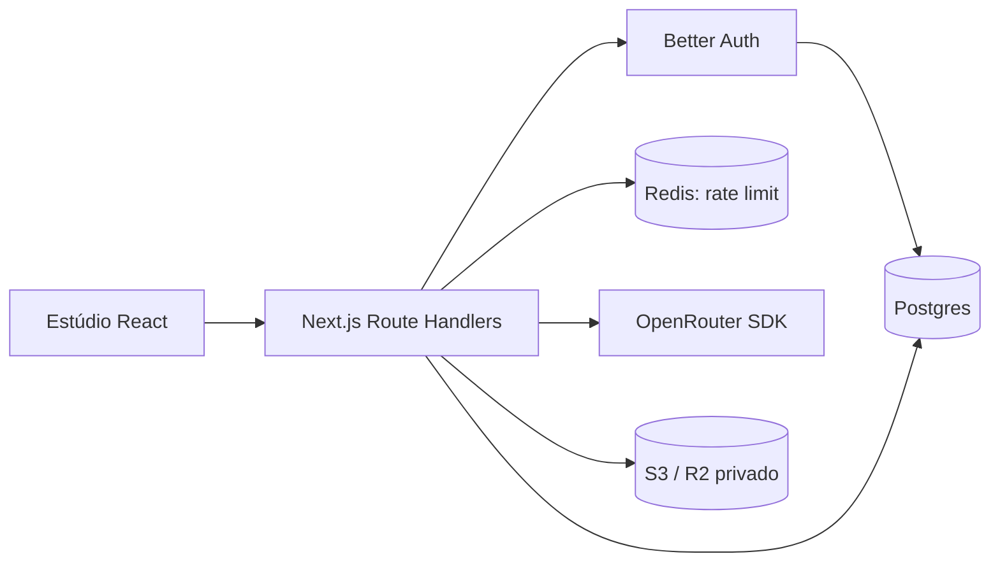

# Arquitetura e decisões

OpenGenUI é uma aplicação Next.js App Router com React e TypeScript. A UI usa componentes próprios e CSS responsivo. As rotas executam no runtime Node.js.



## Persistência

- Better Auth usa tabelas `user`, `session`, `account` e `verification`.
- `workspace` mantém um documento JSONB por usuário com projetos, assistentes, skills e o rascunho de chat. Esta escolha facilita a primeira versão, mas usa a política de última gravação e não oferece edição simultânea segura em múltiplas abas.
- `asset` guarda o proprietário, chave S3, MIME, prompt e projeto. Binários ficam no S3.
- `job` vincula o usuário ao identificador de vídeo OpenRouter e ao arquivo final.
- Chaves estrangeiras possuem índices; as consultas de dados privados sempre filtram `userId` derivado da sessão. O banco é acessado exclusivamente pelo servidor, sem acesso Postgres do navegador.

## Geração

Imagens usam `images.generate`. Base64 é convertido em bytes, enviado ao S3 e registrado no Postgres. Somente PNG/JPEG/WebP são aceitos como saídas raster.

Vídeos usam `videoGeneration.generate`, `getGeneration` e `getVideoContent`. O navegador consulta o job a cada cinco segundos. A rota protege o registro com lock transacional para evitar duplicação de arquivos em consultas concorrentes. O lock permanece durante download/persistência: essa operação deve migrar para um worker antes de escalar.

Os arquivos de referência são resolvidos por ID e proprietário no servidor. URLs arbitrárias do cliente não são usadas como referência. O modelo recebe URLs S3 assinadas. Modelos e parâmetros precisam ser compatíveis; a primeira versão delega parte dessa validação ao OpenRouter e retorna um erro caso o provedor recuse a requisição.

A chave OpenRouter é da instância, não do usuário. Os limites Redis reduzem abuso de frequência, mas não substituem limites financeiros. Submissões ainda não têm idempotência: uma falha de rede após o provedor aceitar um pedido pode deixar uma geração sem registro. Não há retry automático na aplicação. O registro e o objeto S3 não têm transação distribuída; falhas parciais podem deixar objetos órfãos.

## Skills

Upload local de Markdown ou importação por URL HTTPS em `raw.githubusercontent.com`, sem redirecionamentos. O download tem timeout e tamanho limitado. Apenas o conteúdo do `SKILL.md` é usado como orientação criativa. Nada é instalado no servidor nem executado no shell.

## Limites da alpha

- Um rascunho de chat por conta; “Nova criação” limpa esse rascunho. Arquivos continuam na biblioteca.
- Workspace limitado a 100 projetos, 100 assistentes, 100 skills e 500 mensagens; leitura da biblioteca limitada aos 200 arquivos mais recentes.
- Upload via aplicação com limite de 20 MB; um proxy deve limitar também o corpo de requisições antes de colocá-lo em memória.
- Download de vídeo é atualmente carregado em memória; exigir limites e streaming em um worker para produção.
- Não há recuperação automática de jobs, limpeza de objetos órfãos, quotas de armazenamento ou deleção de arquivos.
- Sem confirmação de e-mail ou fluxo de recuperação de senha na UI.
- Sem testes pagos de geração. Foram validados demonstração desktop/mobile, migração, cadastro/login, isolamento entre contas, limite Redis e upload/leitura S3 local. O script `tests/integration.ts` cria e remove duas contas de teste em uma instância configurada, sem chamar modelos pagos.

## Referências técnicas

- [OpenRouter: geração de imagens](https://openrouter.ai/docs/guides/overview/multimodal/image-generation)
- [OpenRouter: geração de vídeos](https://openrouter.ai/docs/guides/overview/multimodal/video-generation)
- [OpenRouter: SDK TypeScript](https://openrouter.ai/docs/client-sdks/typescript/overview)
- [Better Auth: Next.js](https://better-auth.com/docs/integrations/next)
- [Better Auth: Drizzle](https://better-auth.com/docs/adapters/drizzle)
- [skills.sh](https://skills.sh/docs)

As assinaturas efetivas foram verificadas contra os tipos da versão instalada de `@openrouter/sdk`; o SDK usa objetos como `imageGenerationRequest` e `videoGenerationRequest`.

## Executar a integração local

Com uma instância isolada em `http://127.0.0.1:3001`, configure `BETTER_AUTH_URL` para essa origem e carregue um arquivo de ambiente de teste:

```bash
node --env-file=/caminho/test.env ./node_modules/next/dist/bin/next start --hostname 127.0.0.1 --port 3001
node --env-file=/caminho/test.env --import tsx tests/integration.ts
```

O script valida cadastro/login, isolamento de workspace e arquivos, upload S3, URL assinada, origem de requisições, referências inválidas e rate limiting Redis. Ele remove as contas e o objeto que cria. Use um banco e bucket de desenvolvimento.
